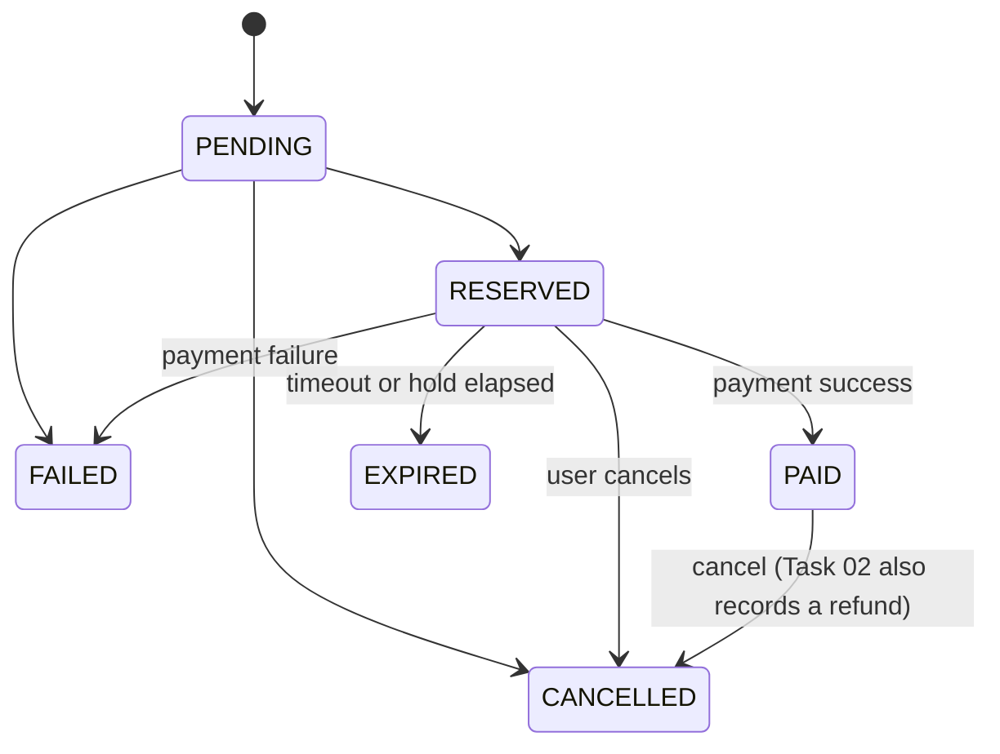

# Techloom.ai Software Engineer Intern: Practical Assessment

Two concurrency-safe commerce systems built with **FastAPI, PostgreSQL and React**: a POS order and inventory system (Task 01) and an e-commerce storefront with checkout, mock payments and refunds (Task 02). Both use the same demo catalogue, a school-supplies shop called **StudyHub**.

## Live links

| | Link |
|---|---|
| **Repository** | https://github.com/Sanjeewa3060/techloom-practical-assessment |
| **Task 01 - POS (live app)** | `https://<task-01-frontend>.vercel.app` |
| Task 01 - API docs | `https://<task-01-api>.onrender.com/docs` |
| **Task 02 - Storefront (live app)** | `https://<task-02-frontend>.vercel.app` |
| Task 02 - API docs | `https://<task-02-api>.onrender.com/docs` |
| Demo video (optional) | `https://...` |

> **Note:** the APIs run on a free Render instance that sleeps after inactivity. The first request can take 30 to 60 seconds while it wakes up. Please open an API link once and wait before testing.

## Contents
1. [Features](#features)
2. [Tech stack and repository layout](#tech-stack-and-repository-layout)
3. [Run locally](#run-locally)
4. [Configuration](#configuration)
5. [Deployment](#deployment)
6. [Design decisions](#design-decisions)
7. [API reference](#api-reference)
8. [Testing and how to verify each requirement](#testing-and-how-to-verify-each-requirement)
9. [Limitations and future work](#limitations-and-future-work)

## Features

**Task 01 - POS Order and Inventory System**
- Product CRUD with a live stock view (on shelf, reserved, available)
- Cart, checkout, and stock validation before an order proceeds
- No overselling under simultaneous purchase requests
- 5-minute stock reservation that is released automatically on expiry
- Mock payment gateway with success, failure and timeout outcomes, plus duplicate-submission protection
- Order lifecycle (Pending, Reserved, Paid, Failed, Expired, Cancelled) with enforced transitions
- Cancellation that restores stock, with every action running in a database transaction

**Task 02 - E-Commerce Checkout and Payment System**
- Product listing with search, category, price range, in-stock filter, sorting and pagination
- Product details page, cart management, and checkout that reserves stock before payment
- Mock gateway (success, failure, timeout) with idempotent payments and checkouts
- Order cancellation, simulated refunds for paid orders, and an order history page

## Tech stack and repository layout

| Layer | Technology |
|---|---|
| Backend | Python 3.12, FastAPI, SQLAlchemy 2.0, Pydantic v2 |
| Database | PostgreSQL (Neon in production); SQLite fallback for quick local runs |
| Frontend | React 18, Vite |
| Hosting | Render (API), Vercel (UI), Neon (database) |
| Tests | pytest, httpx |

```
task-01/                    POS Order and Inventory System
  backend/app/              main.py, routers/, services.py, models.py, schemas.py, state.py, seed.py
  backend/tests/            pytest suite and a live concurrency check
  frontend/                 React POS interface
task-02/                    E-Commerce Checkout and Payment System
  backend/                  same structure, plus refunds, search, filters and pagination
  frontend/                 React StudyHub storefront
```

`services.py` holds all business rules (reservation, payment, cancellation, expiry), the routers stay thin, and `state.py` is the single source of truth for order transitions.

## Run locally

Requirements: Python 3.12, Node.js 20+ and Git. PostgreSQL is optional, because the backend falls back to a local SQLite file when `DATABASE_URL` is not set.

**1. Backend** (shown for Task 01; Task 02 is identical)
```powershell
cd task-01/backend
python -m venv .venv
.venv\Scripts\Activate.ps1          # macOS/Linux: source .venv/bin/activate
pip install -r requirements.txt
uvicorn app.main:app --reload       # http://localhost:8000/docs
```
On first start the app creates its tables and loads the sample catalogue.

**2. Frontend** (in a second terminal)
```powershell
cd task-01/frontend
npm install
copy .env.example .env              # macOS/Linux: cp .env.example .env
npm run dev                         # http://localhost:5173
```

To run both tasks at once, start Task 02's API on another port (`uvicorn app.main:app --port 8001`) and set `VITE_API_URL=http://localhost:8001` in `task-02/frontend/.env`.

**Reset the demo data** (clears carts, orders and products, then reloads the catalogue):
```powershell
python -m app.seed --reset
```

## Configuration

| Variable | Used by | Default | Purpose |
|---|---|---|---|
| `DATABASE_URL` | API | `sqlite:///./pos.db` | Database connection string (PostgreSQL in production) |
| `RESERVATION_TTL_SECONDS` | API | `300` | Length of the stock hold (5 minutes). Use `20` to demonstrate expiry quickly |
| `EXPIRY_SWEEP_SECONDS` | API | `5` | How often the background job releases expired reservations |
| `CORS_ORIGINS` | API | `*` | Comma-separated list of allowed frontend origins |
| `SEED_ON_START` | API | `true` | Load the sample catalogue when the products table is empty |
| `VITE_API_URL` | UI | `http://localhost:8000` | Base URL of the API (applied at build time) |

Each backend ships a `.env.example`. No secrets are committed to the repository.

## Deployment

| Component | Host | Settings |
|---|---|---|
| Database | Neon | One database per task, so their tables never mix |
| API | Render (Web Service) | Root Directory `task-0X/backend`, Build `pip install -r requirements.txt`, Start `uvicorn app.main:app --host 0.0.0.0 --port $PORT`, env `DATABASE_URL`, `CORS_ORIGINS`, `PYTHON_VERSION=3.12.8` |
| UI | Vercel | Root Directory `task-0X/frontend` (Vite), env `VITE_API_URL` set to the matching Render URL |

Product images live in each frontend's `public/images/` folder, so they deploy together with the UI.

## Design decisions

### Preventing overselling
Stock is never read, checked and then written in separate steps. Every reservation is one atomic statement:

```sql
UPDATE products
SET    stock_reserved = stock_reserved + :qty
WHERE  id = :id AND stock_total - stock_reserved >= :qty
```

If no row is updated, there was not enough stock and the request is rejected with `409`. PostgreSQL serialises competing updates on the same row, so two buyers can never both take the last unit. Rows are always updated in ascending product-id order to avoid deadlocks, and `CHECK` constraints (`stock_reserved >= 0`, `stock_total >= stock_reserved`) act as a final safety net in the database itself.

### Reservation and expiry
Checkout moves units from "available" to "reserved" and stamps the order with `expires_at` (5 minutes ahead). A background task releases expired orders every 5 seconds. Expiry is also enforced on demand, whenever someone pays, lists orders or reads stock, so the numbers stay correct even if the server was asleep.

### Duplicate protection (idempotency)
Clients send an `Idempotency-Key` header with checkout and payment requests. A UNIQUE index on `orders.idempotency_key` and `payments.idempotency_key` makes the database reject duplicates, and the API answers a replay with the original result instead of creating a second order or charge. Paying an order that is already paid returns `409`. On checkout, the cart rows are deleted with a row-count check, so one cart can never become two orders.

### Order lifecycle

Allowed transitions live in `state.py`. Each change is a compare-and-set update (`UPDATE orders SET status = :new WHERE id = :id AND status = :old`), so two racing requests can only win once. Anything else returns `409`. In this implementation an order moves from `PENDING` to `RESERVED` inside the checkout transaction, so `PENDING` is never visible to clients.

### Stock accounting per outcome

| Event | Stock effect |
|---|---|
| Checkout | `stock_reserved` increases |
| Payment success | `stock_total` and `stock_reserved` both decrease (units sold) |
| Payment failure, timeout, expiry, cancel before payment | `stock_reserved` decreases (units released) |
| Cancel after payment | `stock_total` increases (units returned) and, in Task 02, a refund record is created |

### Transactions
Checkout, payment, cancellation and expiry each run in a single database transaction. Any error rolls the whole action back, so inventory and orders cannot end up half-updated.

### Mock payment gateway
The client chooses `success`, `failure` or `timeout` to demonstrate each path. If no outcome is given, the gateway picks one at random (70% success, 20% failure, 10% timeout).

## API reference

Identity is a demo-level `X-User-Id` header (the UI generates one per browser). Interactive documentation is available at `/docs` on each API.

| Method and path | Purpose | Task |
|---|---|---|
| `GET /products` | List products. Task 02 adds `search`, `category`, `min_price`, `max_price`, `in_stock`, `sort`, `page`, `page_size`; total matches are in the `X-Total-Count` header | 1, 2 |
| `GET /products/stock` | Live stock levels for every product | 1, 2 |
| `GET /products/categories` | Distinct categories | 2 |
| `POST /products`, `GET/PUT/DELETE /products/{id}` | Product CRUD | 1, 2 |
| `GET /cart`, `PUT /cart/items`, `DELETE /cart` | Cart management (`PUT` sets a quantity; `0` removes the item) | 1, 2 |
| `POST /checkout` | Validate stock, reserve it for 5 minutes, create a `RESERVED` order (`Idempotency-Key` supported) | 1, 2 |
| `POST /orders/{id}/pay` | Mock payment with body `{"outcome": "success" \| "failure" \| "timeout"}` | 1, 2 |
| `POST /orders/{id}/cancel` | Cancel an order and restore stock | 1, 2 |
| `POST /orders/{id}/refund` | Refund a paid order (cancel plus a simulated refund) | 2 |
| `GET /orders`, `GET /orders/{id}` | Order list (optional `user_id` filter) and a single order | 1, 2 |
| `GET /health` | Health check | 1, 2 |

## Testing and how to verify each requirement

**Automated**
```powershell
cd task-01/backend
pytest -q                                              # 6 tests: reservation, payments, duplicates, cancellation, expiry, overselling
python tests/concurrency_check.py http://localhost:8000 --stock 5 --buyers 30

cd ../../task-02/backend
pytest -q                                              # 9 tests: the above plus search, filters, pagination, refunds
```
`concurrency_check.py` creates a product with 5 units, fires 30 simultaneous checkouts and asserts that exactly 5 succeed and none are oversold. It can target any running API, including the deployed one. For the most meaningful result run it against PostgreSQL, because SQLite serialises writes differently. Run `python -m app.seed --reset` afterwards to remove the test product.

**Manual checks**

| Requirement | How to verify |
|---|---|
| Concurrency handling | Run the concurrency script above and look for `PASS` |
| Reservation and timeout | Start the API with `RESERVATION_TTL_SECONDS=20`, check out, wait 20 seconds: the order becomes `EXPIRED` and the stock returns |
| Payment handling | Pay with Success, Failure and Timeout and compare the resulting status and stock. Double-click Success: only one payment is stored |
| Duplicate submission | In `/docs`, send `POST /checkout` twice with the same `Idempotency-Key`: the second call returns the same order |
| Order lifecycle | Cancel reserved and paid orders (stock returns). Cancelling or paying an already cancelled order returns `409` |
| Data integrity | A checkout that fails for lack of stock leaves every stock number unchanged |
| Task 02 discovery | Search, filter by category and price, toggle in-stock only, sort, change page, open a product page |
| Task 02 refund | Pay an order, then use "Cancel and refund" on the My Orders page: a refund appears and stock is restored |

## Limitations and future work
- **No authentication:** users are identified by a generated id in a header. A real system would add login and per-user authorisation.
- **Schema management:** tables are created at startup. A production system would use migrations such as Alembic.
- **Mock payments only:** no real payment provider is integrated.
- **Free-tier hosting:** the API sleeps when idle, and expiry sweeps pause while it is asleep. Expiry is also enforced on demand, so stock is still correct when it wakes.
- **Next steps:** a retry queue for the payment callback, an admin dashboard, and stock-level audit history.

## Acknowledgements
Built with [FastAPI](https://fastapi.tiangolo.com/), [SQLAlchemy](https://www.sqlalchemy.org/), [Pydantic](https://docs.pydantic.dev/), [React](https://react.dev/) and [Vite](https://vitejs.dev/). Product images are simple original illustrations created for this project.
